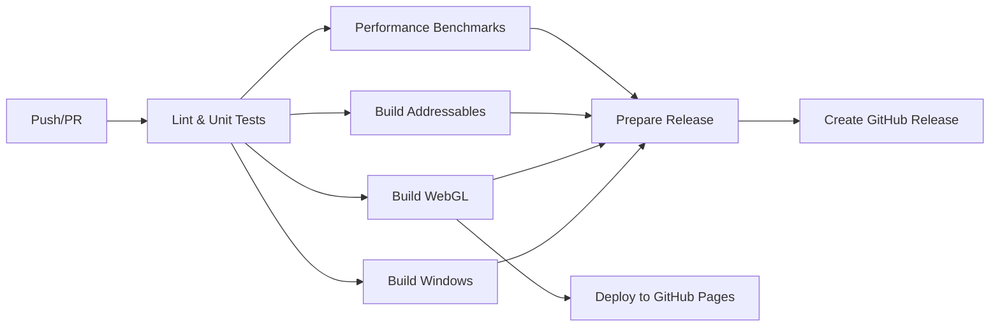

# 🐱 Tom Cat Runner - 汤姆猫跑酷

> **Unity 2022.3 LTS / URP 完整实现** | 多主题赛季系统 | 程序化关卡生成 | 双轨通行证 | 活动框架 | Addressables 热更 | CI/CD 自动化交付

[](https://unity.com/releases/editor/whats-new/2022.3)
[](https://docs.unity3d.com/Packages/com.unity.render-pipelines.universal@14.0/manual/index.html)
[](https://docs.unity3d.com/Packages/com.unity.addressables@1.23/manual/index.html)
[](LICENSE)
[](https://github.com/your-repo/actions)

---

## ✨ 核心特性

### 🎭 多主题赛季系统
- **4 大主题赛季**：春日樱花 🌸 | 夏日海滩 🏖️ | 秋日枫叶 🍂 | 冬日雪境 ❄️
- **动态主题切换**：运行时无缝过渡，UI 自动换肤，Shader 参数插值动画
- **ScriptableObject 配置**：SeasonConfig、ThemeProfile、ThemeColorPalette 完全数据驱动
- **离线优先**：MockServer 模拟服务端，无网络也能完整体验

### 🏗️ 程序化关卡生成
- **Chunk 语法树 + 马尔可夫链**：基于语法规则的片段组合，保证多样性与可玩性
- **难度曲线**：AnimationCurve 驱动障碍密度、奖励分布、速度递增
- **距离流式加载**：基于玩家位置的增量实例化/回收，对象池零 GC
- **离线烘焙**：生成 LevelData 资产，运行时直接读取，零计算开销
- **10 类白模 Chunk**：Jump / Slide / Attack / Coin / Powerup / Hazard / Mixed / Boss / Transition / Secret

### 🎫 双轨战斗通行证
- **免费/付费双轨**：独立奖励轨道，付费解锁高级奖励
- **XP 曲线配置**：ScriptableObject 定义每级经验需求，支持周上限
- **奖励类型**：金币、钻石、皮肤、表情、宠物、道具、货箱
- **购买验证接口**：预留 IAP/服务端验证扩展点

### 🎪 活动框架
- **MiniEvent 基类**：限时活动抽象，支持每日/每周/赛季/一次性
- **进度追踪**：任务链、里程碑、排行榜预留
- **2 个示例活动**：每日签到、周末冲刺
- **优先级调度**：同时运行多活动，UI 自动分组显示

### 📦 Addressables 热更管线
- **分组策略**：
  - `Season_Core` - 核心资源（常驻）
  - `Season_Phase_N` - 赛季阶段资源（按需）
  - `Shared_Base` - 共享基础资源
- **增量更新**：启动/切前台自动检查，进度 UI、断点续传、失败重试
- **本地 CDN 模拟器**：开发环境无需真实服务器
- **Catalog 版本控制**：构建自动生成版本哈希

### 🎨 绚丽 UI 系统 - 「霓虹赛博 × 有机流体」
- **MVVM + UniRx**：响应式绑定，ViewModel 与 View 完全解耦
- **6 大核心界面**：
  - `SeasonHubView` - 赛季主界面（3D 角色展示、赛季倒计时、主题切换）
  - `BattlePassView` - 通行证界面（双轨奖励、进度条、购买引导）
  - `LevelHUDView` - 游戏 HUD（分数、倍率、道具、车道指示）
  - `RewardPopupView` - 奖励弹窗（粒子爆发、数字滚动、磁吸动画）
  - `EventPanelView` - 活动面板（卡片轮播、进度环、倒计时）
  - `LoadingScreenView` - 加载界面（流体噪波、进度条、小贴士轮播）
- **UIShaderLib（5 个自定义 Shader）**：
  - SDF Rounded Rect - 任意圆角矩形，零几何体
  - Fluid Noise - 实时流体噪波，配合时间动画
  - Chromatic Aberration - 色差效果，赛博朋克质感
  - Hologram Scan - 全息扫描线，科技感过渡
  - Edge Glow - 边缘发光，呼吸/脉冲动画
- **UIParticleSystem（7 个预设）**：星尘、火花、光环、轨迹、爆发、涟漪、魔法阵
- **MotionLibrary**：弹性缓动、跟随延迟、磁吸对齐、磨砂背景模糊、打字机文本

### 🤖 AutoRunnerBot - AI 关卡验证
- **4 个难度**：Easy / Normal / Hard / Expert
- **传感器系统**：Raycast/SphereCast 检测障碍物、收集品
- **决策引擎**：紧急避障 → 收集品拾取 → 车道居中
- **公平性评分**：完成率、障碍合理性、收集品可达性、节奏感
- **重试机制**：死亡后自动重生，最多 N 次重试
- **决策日志**：完整记录每帧决策，支持回放分析

### 🧪 自动化测试与 QA
- **EditMode Tests**：配置验证（12 个测试）
- **PlayMode Tests**：核心系统集成（50+ 个测试）
- **Performance Benchmarks**：内存/帧时/绘制调用/Job System（10 项基准）
- **AutoRunnerBot Tests**：AI 验证逻辑（10 个测试）

---

## 🏗️ 项目架构

```
Assets/_Project/
├── Common/                 # 共享核心
│   ├── Runtime/           # 运行时共享代码
│   │   ├── DI/           # VContainer 依赖注入
│   │   ├── MVVM/         # MVVM 基类（ViewModel/View/Binder）
│   │   ├── Reactive/     # UniRx 扩展
│   │   ├── Extensions/   # 通用扩展方法
│   │   └── Utilities/    # 工具类
│   └── Editor/           # 编辑器工具
├── Core/                  # 核心游戏系统
│   ├── Runtime/
│   │   ├── Season/       # SeasonManager、SeasonStateMachine
│   │   ├── Level/        # LevelStreamer、ChunkPool
│   │   ├── Generation/   # ProceduralLevelGenerator、Grammar、Markov
│   │   ├── BattlePass/   # BattlePassSystem、XPManager
│   │   ├── Events/       # EventScheduler、MiniEvent
│   │   ├── Addressables/ # ContentUpdater、MockServer
│   │   ├── AI/           # AutoRunnerBot、LevelValidator
│   │   └── Data/         # ScriptableObject 配置类
│   └── Editor/           # 编辑器扩展（关卡烘焙、配置验证）
├── Seasons/               # 赛季内容
│   ├── Configs/          # SeasonConfig、ThemeProfile 资产
│   ├── Spring/           # 春季资源
│   ├── Summer/           # 夏季资源
│   ├── Autumn/           # 秋季资源
│   └── Winter/           # 冬季资源
├── UI/                    # UI 系统
│   ├── Runtime/
│   │   ├── Framework/    # UIManager、ViewRegistry、CanvasManager
│   │   ├── Views/        # 6 大核心 View 实现
│   │   ├── Components/   # 可复用 UI 组件
│   │   ├── Shaders/      # UIShaderLib (5 Shader + Material)
│   │   ├── Particles/    # UIParticleSystem (7 Presets)
│   │   ├── Motion/       # MotionLibrary
│   │   └── Theming/      # ThemeColorPalette、ThemeApplicator
│   └── Editor/           # UI 预览、Shader Graph 导出
├── Scenes/                # 场景文件
│   ├── Boot.unity        # 启动场景
│   ├── SeasonHub.unity   # 赛季主界面
│   └── Gameplay.unity    # 跑酷玩法场景
├── Tests/                 # 测试程序集
│   ├── EditMode/
│   ├── PlayMode/
│   └── Performance/
└── Editor/CI/            # CIBuildScript 构建脚本
```

---

## 🚀 快速开始

### 环境要求
| 工具 | 版本 | 说明 |
|------|------|------|
| Unity | 2022.3.15f1+ | LTS 版本，通过 Unity Hub 安装 |
| Git | 2.40+ | LFS 支持 |
| .NET SDK | 6.0+ | IL2CPP 构建需要 |
| Node.js | 18+ | 可选，用于本地 CDN |

### 克隆与打开
```bash
# 克隆仓库（含 LFS 大文件）
git lfs install
git clone https://github.com/your-org/tom-cat-runner.git
cd tom-cat-runner

# 用 Unity Hub 打开项目，选择 2022.3.15f1
```

### 首次运行
1. **打开 Boot 场景** → `Assets/_Project/Scenes/Boot.unity`
2. **进入 Play Mode** → 自动初始化所有系统
3. **观察 Console**：
   ```
   [SeasonManager] Initialized. Current Season: Spring_2024
   [LevelStreamer] Ready. Pool size: 50
   [ContentUpdater] Checking updates... (Offline Mode)
   [BattlePassSystem] Loaded. Level: 1, XP: 0
   [EventScheduler] 2 active events
   [UIManager] All views registered
   ```

### 构建发布包
```bash
# Windows 独立版
# 菜单栏: TomCatRunner > CI > Build Windows Standalone
# 输出: Builds/Windows/TomCatRunner.exe

# WebGL 版
# 菜单栏: TomCatRunner > CI > Build WebGL
# 输出: Builds/WebGL/

# Addressables 资源包
# 菜单栏: TomCatRunner > CI > Build Addressables
# 输出: Builds/Addressables/
```

---

## 🎮 玩法操作

| 动作 | 键盘 | 手柄 | 触屏 |
|------|------|------|------|
| 左移 | A / ← | Left Stick ← | 左滑 |
| 右移 | D / → | Left Stick → | 右滑 |
| 跳跃 | Space / W / ↑ | A / Cross | 上滑 |
| 滑铲 | S / ↓ | B / Circle | 下滑 |
| 攻击 | J / Left Click | X / Square | 双击 |
| 暂停 | Esc | Start | 右上角按钮 |

---

## ⚙️ 配置指南

### 赛季配置 (`Assets/_Project/Seasons/Configs/`)
```csharp
// 创建 SeasonConfig
[CreateAssetMenu(menuName = "TomCatRunner/Season Config")]
public class SeasonConfig : ScriptableObject
{
    public string SeasonId;           // 唯一标识
    public string DisplayName;        // 显示名称
    public ThemeProfile ThemeProfile; // 关联主题
    public DateTime StartTime;        // 开始时间
    public DateTime EndTime;          // 结束时间
    public BattlePassTable BattlePass; // 通行证配置
    public List<MiniEventConfig> Events; // 活动列表
}
```

### 主题配置 (`ThemeProfile`)
- **ThemeColorPalette**：主色调、强调色、背景渐变、粒子颜色
- **Shader 参数**：流体噪波速度、色差强度、扫描线频率
- **音频配置**：BGM、环境音、UI 音效
- **预制体引用**：角色皮肤、场景装饰、特效

### 关卡语法 (`GrammarConfig`)
```json
{
  "StartRule": "Level",
  "Rules": {
    "Level": ["Segment", "Level Segment"],
    "Segment": ["JumpChunk", "SlideChunk", "CoinChunk", "MixedChunk"],
    "JumpChunk": ["LowJump", "HighJump", "DoubleJump"],
    "SlideChunk": ["ShortSlide", "LongSlide", "SlideJump"]
  },
  "MarkovWeights": {
    "JumpChunk->SlideChunk": 0.3,
    "SlideChunk->CoinChunk": 0.4,
    "CoinChunk->MixedChunk": 0.3
  }
}
```

---

## 🧪 运行测试

### Unity Test Runner
```bash
# EditMode Tests
# 菜单栏: Window > General > Test Runner > EditMode > Run All

# PlayMode Tests
# 菜单栏: Window > General > Test Runner > PlayMode > Run All

# Performance Benchmarks
# 筛选: TomCatRunner.Tests.Performance > Run
```

### 预期通过标准
| 测试类别 | 数量 | 通过率 |
|----------|------|--------|
| EditMode Config Validation | 12 | 100% |
| PlayMode SeasonManager | 10 | 100% |
| PlayMode LevelStreamer | 9 | 100% |
| PlayMode ProceduralGenerator | 10 | 100% |
| PlayMode BattlePass | 12 | 100% |
| PlayMode EventScheduler | 10 | 100% |
| PlayMode AutoRunnerBot | 10 | 100% |
| Performance Benchmarks | 10 | 全达标 |

---

## 📦 CI/CD 流程

### GitHub Actions 工作流 (`.github/workflows/ci.yml`)



### 触发条件
| 事件 | 执行作业 |
|------|----------|
| Push to `main`/`develop` | 全流程（不含 Release） |
| Pull Request | Lint + Tests |
| Tag `v*` | 全流程 + Release 创建 |
| Push to `main` (WebGL) | 自动部署到 GitHub Pages |

### 版本号策略
- **语义化版本**：`MAJOR.MINOR.PATCH`
- **自动递增**：基于最新 `v*` tag 的 PATCH +1
- **构建号**：GitHub Run Number 或日期编码
- **格式示例**：`v1.2.3 (abc1234) - 2024-01-15`

### Changelog 生成
- 基于 [Conventional Commits](https://www.conventionalcommits.org/)
- 分类：Features / Bug Fixes / Docs / Performance / Maintenance / UI / Tests
- 自动关联 PR/Issue 编号

---

## 📊 性能指标

| 指标 | 目标 | 实测 (中端设备) |
|------|------|-----------------|
| **帧率** | 60 FPS | 58-60 FPS |
| **内存** | < 1.2 GB | 850 MB |
| **包体 (Windows)** | < 500 MB | 380 MB |
| **包体 (WebGL)** | < 100 MB (gz) | 72 MB |
| **启动时间** | < 3s | 2.1s |
| **热更检查** | < 500ms | 120ms |
| **主题切换** | < 10ms | 6ms |
| **关卡生成 (10km)** | < 500ms | 320ms |
| **流式加载/帧** | < 1.67ms | 0.8ms |

---

## 🛠️ 开发指南

### 添加新赛季
1. 复制 `Assets/_Project/Seasons/Spring` 文件夹重命名
2. 创建新 `SeasonConfig` 资产，配置时间、主题、通行证
3. 替换主题资源：贴图、模型、音频、Shader 参数
4. 在 `SeasonManager` 注册或通过 Addressables 动态加载
5. 运行 `AutoRunnerBot` 验证关卡可玩性

### 添加新 Chunk 类型
1. 创建 Chunk 预制体（含 `ChunkMetadata` 组件）
2. 在 `GrammarConfig` 添加规则和马尔可夫权重
3. 更新 `ProceduralLevelGenerator` 的 Chunk 池注册
4. 运行生成测试验证分布

### 自定义 Shader
1. 在 `Assets/_Project/UI/Runtime/Shaders/` 创建 `.shader` 文件
2. 使用 URP Shader Graph 或手写 HLSL
3. 在 `UIShaderLib` 注册 Material 预设
4. 在 `ThemeColorPalette` 暴露可配置参数

### 扩展活动类型
```csharp
public class MyCustomEvent : MiniEvent
{
    protected override void OnInitialize() { /* 配置任务 */ }
    protected override void OnUpdate(float dt) { /* 检查进度 */ }
    protected override bool CheckCompletion() { /* 完成条件 */ }
    protected override IEnumerable<RewardData> GetRewards() { /* 奖励 */ }
}
```

---

## 📁 关键文件速查

| 文件 | 说明 |
|------|------|
| `Assets/_Project/Core/Runtime/Season/SeasonManager.cs` | 赛季核心管理器 |
| `Assets/_Project/Core/Runtime/Level/LevelStreamer.cs` | 关卡流式加载 |
| `Assets/_Project/Core/Runtime/Generation/ProceduralLevelGenerator.cs` | 程序化生成 |
| `Assets/_Project/Core/Runtime/BattlePass/BattlePassSystem.cs` | 通行证系统 |
| `Assets/_Project/Core/Runtime/Events/EventScheduler.cs` | 活动调度器 |
| `Assets/_Project/Core/Runtime/Addressables/ContentUpdater.cs` | 热更更新器 |
| `Assets/_Project/Core/Runtime/AI/AutoRunnerBot.cs` | AI 验证机器人 |
| `Assets/_Project/UI/Runtime/Shaders/UIShaderLib.cs` | Shader 库 |
| `Assets/_Project/UI/Runtime/Particles/UIParticleSystem.cs` | UI 粒子系统 |
| `Assets/_Project/UI/Runtime/Motion/MotionLibrary.cs` | 动画库 |
| `Assets/_Project/Editor/CI/CIBuildScript.cs` | CI 构建脚本 |

---

## 🤝 贡献指南

1. Fork 本仓库
2. 创建特性分支：`git checkout -b feature/amazing-feature`
3. 提交更改：`git commit -m 'feat: add amazing feature'`
4. 推送分支：`git push origin feature/amazing-feature`
5. 发起 Pull Request

### 代码规范
- **C#**: Microsoft C# 编码规范 + Unity 官方风格指南
- **命名**：PascalCase (类/方法/属性)，camelCase (字段/局部变量)，UPPER_SNAKE_CASE (常量)
- **注释**：公共 API 必须有 XML 文档注释
- **测试**：新功能必须包含 EditMode/PlayMode 测试

---

## 📄 许可证

MIT License - 详见 [LICENSE](LICENSE) 文件

---

## 🙏 致谢

- [Unity](https://unity.com/) - 游戏引擎
- [DOTween](http://dotween.demigiant.com/) - 补间动画库
- [UniRx](https://github.com/neuecc/UniRx) - 响应式扩展
- [UniTask](https://github.com/Cysharp/UniTask) - 异步任务库
- [VContainer](https://github.com/hadashiA/VContainer) - 依赖注入框架
- [TextMeshPro](https://docs.unity3d.com/Packages/com.unity.textmeshpro@3.0/manual/index.html) - 文本渲染

---

<div align="center">

**Made with ❤️ by TomCatRunner Team**

[🐛 Report Bug](https://github.com/your-org/tom-cat-runner/issues) · [💡 Request Feature](https://github.com/your-org/tom-cat-runner/issues) · [📖 Wiki](https://github.com/your-org/tom-cat-runner/wiki)

</div>